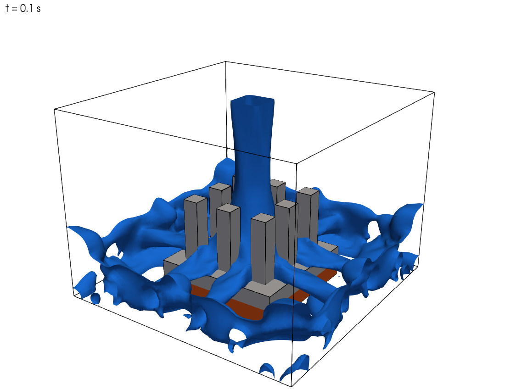
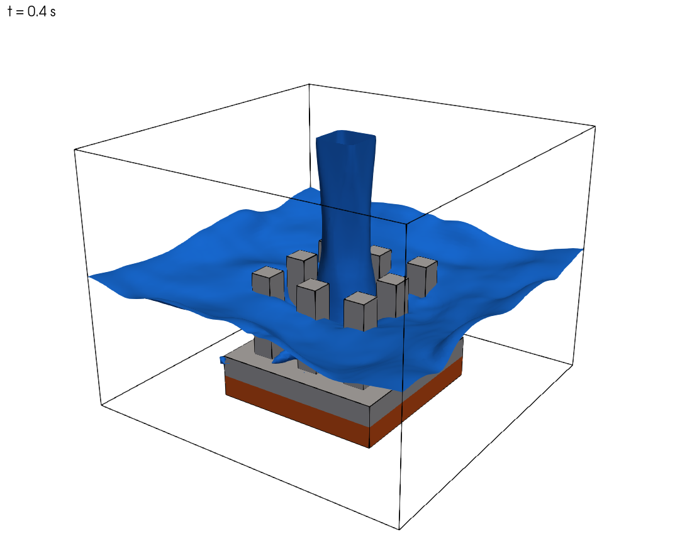

# 예제 19. 다상 유동 + 켤레 열전달 (VOF + CHT): 핀-휜 히트싱크의 액체 제트 충돌 냉각

> 사용 솔버: `chtMultiRegionInterFoam` (사용자 추출/포팅 솔버, OpenFOAM v2412)
> 케이스 경로: `examples/pinFinJetCooling`

## 목차

1. [배경](#1-배경)
2. [전처리](#2-전처리)
3. [솔버 실행](#3-솔버-실행)
4. [후처리](#4-후처리)
5. [확장 및 주의사항](#5-확장-및-주의사항)
6. [부록: 솔버 추출 및 빌드](#6-부록-솔버-추출-및-빌드)

---

## 1. 배경

### 1.1 문제 정의

이 예제에서는 고성능 GPU 칩에서 발생하는 열을 **핀-휜 히트싱크(pin-fin heat sink)** 와 **액체 제트 충돌(liquid jet impingement)** 로 냉각하는 과정을 해석한다. 물리적으로 서로 다른 세 개의 영역이 동시에 등장한다.

- **chip** : 발열하는 실리콘 다이(die). 일정 전력 `150 W` 를 균일하게 발생시킨다.
- **heatSink** : 칩 위에 부착된 알루미늄 히트싱크. 바닥판(base)과 3 x 3 사각 핀으로 구성된다.
- **fluid** : 히트싱크 주위의 유체 영역. 초기에는 공기로 가득 차 있고, 상단 노즐에서 **물 제트**가 아래로 분사되어 핀에 충돌·냉각한다.

즉 이 문제는 두 가지 물리가 결합되어 있다.

1. **다상 유동 (VOF)** — 물과 공기가 뚜렷한 계면을 사이에 두고 분리되어 흐른다. 예제 8의 `interFoam` 댐 붕괴와 동일한 계면 포착(interface capturing) 기법을 사용한다.
2. **켤레 열전달 (Conjugate Heat Transfer, CHT)** — 고체(칩, 히트싱크)의 열전도와 유체의 대류 열전달이 고체-유체 계면에서 연속적으로 연결된다. 예제 13의 `chtMultiRegionFoam` 와 동일한 다중 영역 결합을 사용한다.

```text
                    │  │   물 제트 (1.5 m/s, 300 K)
                    ▼  ▼
        ┌───────────────────────────┐  ← outlet (상단, 공기/물 배출)
        │      nozzle (4 x 4 mm)     │
        │   ┌──┐  ┌──┐  ┌──┐         │
        │   │  │  │  │  │  │  핀(Al)  │   fluid (공기 + 물, VOF)
        │   │  │  │  │  │  │  8 mm    │
        │ ══╧══╧══╧══╧══╧══╧══  바닥판 │
        │ ▓▓▓▓▓▓▓▓▓▓▓▓▓▓▓▓▓▓▓  chip(Si, 150 W) │
        └───────────────────────────┘  ← bottom (단열)
              32 x 24 x 32 mm
```

*상단 노즐에서 분사된 물 제트가 칩 위 알루미늄 핀-휜 히트싱크(3 x 3 핀)에 충돌하여 냉각한다.*

### 1.2 왜 새 솔버가 필요한가

표준 OpenFOAM 솔버만으로는 이 문제를 한 번에 풀 수 없다.

| 솔버 | 다상(VOF) | 에너지 방정식 | 다중 영역 CHT |
|:---|:---:|:---:|:---:|
| `interFoam` | O | X (등온) | X |
| `compressibleInterFoam` | O | O | X (단일 영역) |
| `chtMultiRegionFoam` | X (단상) | O | O |
| **`chtMultiRegionInterFoam`** | **O** | **O** | **O** |

`chtMultiRegionInterFoam` 은 **유체 영역에서는 `compressibleInterFoam`(압축성 2상 VOF + 에너지)** 을, **고체 영역에서는 `chtMultiRegionFoam`(열전도)** 를 사용하고, 두 영역을 온도 결합 경계조건으로 묶은 솔버이다. 즉 `interFoam` 과 `chtMultiRegionFoam` 을 합친 형태이다.

> **Note:** 이 솔버는 OpenFOAM 기본 배포본에 포함되어 있지 않다. c-schubert 의 [OpenFOAM--MHD--VoF-Solver-Collection](https://github.com/c-schubert/OpenFOAM--MHD--VoF-Solver-Collection) 에서 추출하여 v2412 로 포팅하였다. 솔버 추출·빌드 방법은 [부록](#6-부록-솔버-추출-및-빌드)에 정리한다.

### 1.3 지배 방정식

**유체 영역 (압축성 2상 VOF).** 물의 체적 분율 $\alpha_1$ 에 대한 이류(advection) 방정식을 MULES 로 푼다.

$$\frac{\partial \alpha_1}{\partial t} + \nabla\cdot(\alpha_1 \mathbf{U}) + \nabla\cdot\big(\alpha_1(1-\alpha_1)\,\mathbf{U}_r\big) = 0$$

혼합물 밀도·점성은 $\rho = \alpha_1\rho_1 + \alpha_2\rho_2$, $\mu = \alpha_1\mu_1 + \alpha_2\mu_2$ 로 정의된다. 운동량 방정식에는 중력과 표면장력(연속 표면력, CSF)이 포함된다.

$$\frac{\partial(\rho\mathbf{U})}{\partial t} + \nabla\cdot(\rho\mathbf{U}\mathbf{U}) = -\nabla p_{rgh} - (\mathbf{g}\cdot\mathbf{x})\nabla\rho + \nabla\cdot\boldsymbol{\tau} + \sigma\kappa\nabla\alpha_1$$

에너지 방정식은 온도 $T$ 형태로 풀린다.

**고체 영역 (열전도).** 엔탈피 $h$ 에 대한 전도 방정식을 풀고, 칩 영역에는 발열원 $\dot{q}$ 가 더해진다.

$$\frac{\partial(\rho h)}{\partial t} - \nabla\cdot(\alpha_h \nabla h) = \dot{q}$$

**계면 결합.** 고체-유체, 고체-고체 계면에서 온도와 열유속이 연속이 되도록 `compressible::turbulentTemperatureRadCoupledMixed` 경계조건이 양쪽 영역의 $T$ 를 결합한다.

$$T_s = T_f, \qquad k_s \frac{\partial T_s}{\partial n} = k_f \frac{\partial T_f}{\partial n}$$

---

## 2. 전처리

### 2.1 케이스 디렉터리 구조

다중 영역 케이스는 `constant/`, `system/`, `0/` 아래에 **영역별 하위 폴더**를 둔다.

```bash
pinFinJetCooling
├── Allrun                      # 전체 실행 스크립트
├── Allclean
├── constant
│   ├── g                       # 중력 (전역)
│   ├── regionProperties        # 영역 목록 (fluid / solid)
│   ├── fluid
│   │   ├── thermophysicalProperties        # phases (water air)
│   │   ├── thermophysicalProperties.water  # 물 (perfectFluid)
│   │   ├── thermophysicalProperties.air    # 공기 (perfectGas)
│   │   ├── turbulenceProperties            # laminar
│   │   └── radiationProperties             # none
│   ├── heatSink
│   │   └── thermophysicalProperties        # 알루미늄 (heSolidThermo)
│   └── chip
│       └── thermophysicalProperties        # 실리콘 (heSolidThermo)
├── system
│   ├── blockMeshDict           # 배경 격자
│   ├── topoSetDict             # chip/heatSink/fluid 셀존 + 노즐 면집합
│   ├── createPatchDict         # nozzle 패치 생성
│   ├── controlDict
│   ├── fvSchemes / fvSolution  # 전역(상위) 설정
│   ├── fluid    {fvSchemes, fvSolution}
│   ├── heatSink {fvSchemes, fvSolution}
│   └── chip     {fvSchemes, fvSolution, fvOptions(발열원)}
└── 0.orig                      # 초기/경계장 (Allrun 이 0/ 로 복사)
    ├── fluid    {alpha.water, U, T, p, p_rgh}
    ├── heatSink {T, p}
    └── chip     {T, p}
```

### 2.2 격자 생성

핀-휜 형상은 다음 네 단계로 생성한다. 모든 핀이 격자선에 정확히 정렬되는 정육면체(Cartesian) 격자를 쓰므로 격자 품질이 완벽하다(비직교도 0). 본 예제는 셀 크기를 1/3 mm 로 3배 조밀화하여 96 x 72 x 96 = 663,552 셀을 사용한다. `topoSetDict` 는 절대 좌표(m)로 영역을 정의하므로 격자를 조밀화해도 그대로 동작한다.

```bash
blockMesh                                   # 32 x 24 x 32 mm, 1/3 mm 셀 (96 x 72 x 96, 단일 블록)
topoSet                                     # chip/heatSink/fluid 셀존 + nozzle 면집합
createPatch -overwrite                      # 상단 outlet 에서 nozzle 패치 분리
splitMeshRegions -cellZones -overwrite      # 영역별 격자 분할 + 결합 패치 자동 생성
```

`system/blockMeshDict` — mm 단위로 좌표를 적고 `scale 0.001` 로 m 로 변환한다.

```cpp
scale   0.001;

vertices
(
    (  0  0  0 ) (  32  0  0 ) (  32 24  0 ) (  0 24  0 )
    (  0  0 32 ) (  32  0 32 ) (  32 24 32 ) (  0 24 32 )
);

blocks
(
    hex (0 1 2 3 4 5 6 7) (96 72 96) simpleGrading (1 1 1)   // 1/3 mm 셀 (3배 조밀화)
);
```

`system/topoSetDict` — `boxToCell` 로 칩·히트싱크(바닥판 + 9개 핀)·유체 셀존을 정의한다. 핀은 2 mm 사각, 높이 8 mm, 5 mm 피치의 3 x 3 배열이다.

```cpp
actions
(
    // 칩 (실리콘 다이) : x,z [8,24] mm, y [0,2] mm
    { name chipCells; type cellSet; action new; source boxToCell;
      box (0.008 0.000 0.008) (0.024 0.002 0.024); }
    { name chip; type cellZoneSet; action new; source setToCellZone; set chipCells; }

    // 히트싱크 = 바닥판 + 핀 (모두 같은 셀존에 add)
    { name heatSinkCells; type cellSet; action new; source boxToCell;
      box (0.008 0.002 0.008) (0.024 0.004 0.024); }              // 바닥판
    { name heatSinkCells; type cellSet; action add; source boxToCell;
      box (0.010 0.004 0.010) (0.012 0.012 0.012); }              // 핀 1 (이하 9개)
    // ... (핀 2~9) ...
    { name heatSink; type cellZoneSet; action new; source setToCellZone; set heatSinkCells; }

    // 유체 = 전체 - 칩 - 히트싱크
    { name fluidCells; type cellSet; action new; source boxToCell; box (-1 -1 -1) (1 1 1); }
    { name fluidCells; type cellSet; action delete; source cellToCell; set chipCells; }
    { name fluidCells; type cellSet; action delete; source cellToCell; set heatSinkCells; }
    { name fluid; type cellZoneSet; action new; source setToCellZone; set fluidCells; }

    // 노즐 면집합 = 상단 outlet 패치 ∩ 중앙 4 x 4 mm
    { name nozzleFaces; type faceSet; action new;    source patchToFace; patch outlet; }
    { name nozzleFaces; type faceSet; action subset; source boxToFace;
      box (0.014 0.020 0.014) (0.018 0.026 0.018); }
);
```

`splitMeshRegions` 는 각 셀존을 독립 영역 격자로 나누고, 영역이 맞닿는 면에 `<영역>_to_<이웃영역>` 형태의 **결합(mapped) 패치**를 자동 생성한다. 분할 결과는 다음과 같다.

| 영역 | 셀 수 | 패치 |
|:---|:---:|:---|
| fluid | 628,128 | `nozzle`, `outlet`, `walls`, `bottom`, `fluid_to_chip`, `fluid_to_heatSink` |
| heatSink | 21,600 | `heatSink_to_chip`, `heatSink_to_fluid` |
| chip | 13,824 | `bottom`, `chip_to_fluid`, `chip_to_heatSink` |

> **Note:** 칩의 옆면은 유체와 직접 닿으므로 `chip_to_fluid` 패치가 생성된다. 즉 칩은 윗면(히트싱크)과 옆면(유체) 양쪽으로 냉각된다.

### 2.3 영역 정의 — `constant/regionProperties`

```cpp
regions
(
    fluid       (fluid)
    solid       (heatSink chip)
);
```

### 2.4 유체 영역 물성

압축성 2상 혼합물을 정의한다(`twoPhaseMixtureThermo`). 상(phase) 목록·표면장력·최소압력은 `constant/fluid/thermophysicalProperties` 에 둔다.

```cpp
phases          (water air);
pMin            10000;
sigma { type constant; sigma 0.07; }     // 물-공기 표면장력 [N/m]
```

각 상은 별도 파일로 정의한다. 물은 `perfectFluid`(약압축성), 공기는 `perfectGas` 이다.

```cpp
// constant/fluid/thermophysicalProperties.water
thermoType
{
    type            heRhoThermo;     mixture  pureMixture;
    transport       const;           thermo   hConst;
    equationOfState perfectFluid;    specie   specie;
    energy          sensibleInternalEnergy;
}
mixture
{
    specie          { molWeight 18.0; }
    equationOfState { R 3000; rho0 1027; }    // rho ~ 1027 kg/m^3
    thermodynamics  { Cp 4195; Hf 0; }
    transport       { mu 3.645e-4; Pr 2.289; }
}
```

중력은 전역 파일 `constant/g` 에 정의한다(연직 -y 방향).

```cpp
dimensions  [0 1 -2 0 0 0 0];
value       (0 -9.81 0);
```

### 2.5 고체 영역 물성과 발열원

고체는 `heSolidThermo` + `constIso`(등방 열전도 `kappa`) 를 사용한다.

```cpp
// constant/heatSink/thermophysicalProperties  (알루미늄)
mixture
{
    transport       { kappa 205; }       // W/m/K
    thermodynamics  { Hf 0; Cp 900; }
    equationOfState { rho 2700; }
}
// constant/chip/thermophysicalProperties     (실리콘): kappa 149, Cp 705, rho 2329
```

GPU 발열은 칩 영역의 에너지 방정식에 `scalarSemiImplicitSource` 로 `150 W` 를 주입한다(`system/chip/fvOptions`).

```cpp
gpuHeatSource
{
    type            scalarSemiImplicitSource;
    selectionMode   all;            // chip 영역 전체
    volumeMode      absolute;       // [W]
    sources         { h (150 0); }  // (Su Sp): 150 W 발열, 음함수항 0
}
```

### 2.6 경계 및 초기 조건

초기에 영역은 공기로 가득 차 있고(`alpha.water = 0`), 모든 온도는 `300 K` 이다. 주요 경계조건은 다음과 같다.

| 필드 | nozzle (제트 입구) | outlet (상단) | walls / bottom | 고체-유체 계면 |
|:---|:---|:---|:---|:---|
| `alpha.water` | `fixedValue 1` | `inletOutlet 0` | `zeroGradient` | `zeroGradient` |
| `U` | `fixedValue (0 -1.5 0)` | `pressureInletOutletVelocity` | `noSlip` | `noSlip` |
| `T` | `fixedValue 300` | `inletOutlet 300` | `zeroGradient` | **결합 BC** |
| `p_rgh` | `fixedFluxPressure` | `totalPressure 1e5` | `fixedFluxPressure` | `fixedFluxPressure` |

고체-유체, 고체-고체 계면의 온도 결합은 다음과 같이 지정한다(유체쪽은 `kappaMethod fluidThermo`, 고체쪽은 `solidThermo`).

```cpp
// 예) 0.orig/chip/T 의 chip_to_heatSink, chip_to_fluid 패치
type            compressible::turbulentTemperatureRadCoupledMixed;
Tnbr            T;
kappaMethod     solidThermo;
qrNbr           none;   qr   none;
value           uniform 300;
```

> **Note:** 칩 바닥면(`bottom`)은 `zeroGradient`(단열)로 두었다. 따라서 발생한 열은 전부 히트싱크와 유체를 통해서만 빠져나가며, 이는 냉각 성능을 보수적으로 평가하는 설정이다.

### 2.7 수치 기법과 솔버 설정

상위(전역) `system/fvSolution` 은 다중 영역 드라이버가 읽는 외부 보정 횟수와 에너지 결합 부분 루프를 지정한다. `nOuterCorrectors 2` 와 `energyCoupling` 부분 루프를 쓰면, 매 시간 간격 안에서 첫 외부 보정 뒤에 유동을 고정한 채 유체 온도와 고체 전도를 추가로 다시 풀어 영역 간(켤레) 열전달 결합을 **암시적으로(implicit)** 강화한다. 가장 단순하고 견고한 설정을 원하면 `nOuterCorrectors 1` 로 두면 되며, 이 경우 매 간격마다 유체→고체를 한 번씩만 순차로 푸는 완전 명시적(explicit) 결합이 된다.

```cpp
// system/fvSolution (상위)
PIMPLE
{
    nOuterCorrectors 2;
    energyCoupling { iterations 2; }
}
```

유체 영역(`system/fluid/fvSolution`)은 `alpha.water`(MULES), `p_rgh`, `U`, `T` 선형 솔버와 PIMPLE 보정을 둔다.

```cpp
"alpha.water.*"
{
    nAlphaCorr 1; nAlphaSubCycles 2; cAlpha 1;
    MULESCorr no; nLimiterIter 5;
    solver smoothSolver; smoother symGaussSeidel; tolerance 1e-8; relTol 0;
}
PIMPLE { momentumPredictor no; transonic no; nCorrectors 2; nNonOrthogonalCorrectors 0; }
```

`system/controlDict` 은 적응 시간 간격(adjustable time step)을 사용한다. 정육면체 격자라 이산화는 모두 `uncorrected`(비직교 보정 불필요)로 단순화한다. 시간 간격은 유동 Courant 수(`maxCo`)와 **VOF 계면 Courant 수(`maxAlphaCo`)** 의 더 엄격한 쪽, 그리고 고체 확산수로 동시에 제한된다. `maxAlphaCo` 를 `maxCo` 보다 작게 두면 계면을 더 선명하게 유지하면서 시간 간격을 조절할 수 있다.

```cpp
application     chtMultiRegionInterFoam;
endTime         0.5;
deltaT          1e-5;
writeControl    adjustable;   writeInterval 0.02;   writeFormat binary;
adjustTimeStep  yes;
maxCo           0.5;   maxAlphaCo 0.5;   maxDeltaT 1e-3;
```

---

## 3. 솔버 실행

먼저 솔버가 빌드되어 있어야 한다([부록](#6-부록-솔버-추출-및-빌드) 참고). 빌드 후 케이스 실행은 `Allrun` 한 줄로 끝난다.

```bash
cd examples/pinFinJetCooling
./Allclean       # (선택) 이전 결과 정리
./Allrun         # 격자 → 분할 → 16코어 병렬 풀이 → 재구성(reconstruct)
```

`Allrun` 내부는 다음과 같다.

```bash
runApplication blockMesh
runApplication topoSet
runApplication createPatch -overwrite
runApplication splitMeshRegions -cellZones -overwrite
restore0Dir                                       # 0.orig → 0 (영역별)
runApplication decomposePar -allRegions -force    # 영역별 16분할
export OMPI_MCA_rmaps_base_oversubscribe=1        # 물리 코어보다 많은 랭크 허용
runParallel $(getApplication)                     # mpirun -np 16 chtMultiRegionInterFoam -parallel
runApplication reconstructPar -allRegions -newTimes
```

> **Note:** `decomposePar -allRegions` 는 상위 `system/decomposeParDict` 가 아니라 **영역별** `system/<region>/decomposeParDict` 를 읽는다. 따라서 `fluid`, `heatSink`, `chip` 각각에 동일한 분할 설정(`numberOfSubdomains 16; method scotch;`)을 두어야 한다. 또한 물리 코어 수가 랭크 수보다 적은 (하이퍼스레딩) 환경에서는 위처럼 `OMPI_MCA_rmaps_base_oversubscribe` 를 켜거나 `mpirun --use-hwthread-cpus` 를 써야 16 랭크가 기동한다.

실행 로그(`log.chtMultiRegionInterFoam`)에서 다음 줄들을 확인한다.

```bash
Solving for fluid region fluid
MULES: Solving for alpha.water
Phase-1 volume fraction = 0.516 ...  Min(alpha.water) = 0  Max(alpha.water) = 1   # VOF
...
Solving for solid region chip
DICPCG:  Solving for h, Initial residual = ...                                     # 고체 전도
Min/max T:323.8 329.4                                                              # 칩 온도
```

- `Max(alpha.water) = 1` 은 순수한 물 영역(제트·고인 물)이 존재함을 뜻한다.
- `Phase-1 volume fraction` 은 영역 내 물의 총 체적 비율로, 시간이 지나며 증가한다(약 0.5 s 에 ~52 %).
- 각 영역의 `Min/max T` 로 칩·히트싱크 온도 상승을 추적할 수 있다.

이 케이스는 약 664,000 셀이므로 16코어 병렬로 `t = 0.5 s` 까지 약 40~50분 소요된다(약 7,800 시간 간격). 학습 목적으로는 `blockMeshDict` 의 분할 수를 `(32 24 32)` 로 되돌려 단일 코어로 수 분 내에 실행할 수도 있다.

---

## 4. 후처리

### 4.1 칩·히트싱크 온도 이력 (검증)

`controlDict` 의 함수 객체가 칩 최고온도와 히트싱크 평균온도를 매 시간 간격마다 기록한다.

```bash
postProcessing/chip/chipTemperature/0/volFieldValue.dat        # max(T)
postProcessing/heatSink/heatSinkTemperature/0/volFieldValue.dat # volAverage(T)
```

이를 그리면 칩 온도가 `300 K` 에서 상승하다가, 제트 냉각이 발달하면서 상승 기울기가 점차 완만해지는 것을 볼 수 있다.


| 시간 [s] | 칩 max(T) [K] | 히트싱크 평균 T [K] |
|:---:|:---:|:---:|
| 0.04 | 304.7 | 301.1 |
| 0.15 | 312.8 | 306.3 |
| 0.28 | 320.0 | 311.8 |
| 0.49 | 329.1 | 318.9 |

`t = 0.5 s` 시점의 영역별 온도 분포는 다음과 같다.

| 영역 | 온도 범위 [K] | 해석 |
|:---|:---:|:---|
| chip | 323.8 ~ 329.4 | 발열원, 가장 뜨거움 |
| heatSink | 304.7 ~ 326.5 | 바닥판 ~326 K → 핀 끝 ~305 K |

핀 끝(`~305 K`)이 냉각수 온도(`300 K`)에 근접한다는 점이 제트 충돌 냉각이 실제로 작동함을 보여준다. 칩(329 K) → 히트싱크 바닥판(326 K) → 핀 끝(305 K) 으로 이어지는 온도 구배는 **고체 내부 전도 + 계면 켤레 열전달 + 유체 대류**가 일관되게 결합되어 있음을 의미한다. 약 `0.5 s` 동안 칩 온도는 `300 K → 329 K` 로 상승하며, 상승 기울기가 점차 완만해지는 것은 제트 냉각이 발열과 균형을 향해 발달하고 있음을 뜻한다.

### 4.2 물 계면(제트) 거동 — `alpha.water = 0.5` 등가면

VOF 계면(물-공기 경계)은 `alpha.water = 0.5` 등가면으로 가장 잘 드러난다. 아래 그림은 `t = 0, 0.1, 0.2, 0.3, 0.4, 0.5 s` 에서의 **계면(파란색)**, **히트싱크·칩 벽면(고체색: 회색·주황색)**, **도메인 외곽선(특징 에지, feature edge)** 을 함께 보여준다.

| | |
|:---:|:---:|
|  |  |
|  |  |
|  |  |

- `t = 0.0 s` : 도메인은 공기로 차 있어 계면이 없다. 알루미늄 핀-휜 히트싱크(회색)와 실리콘 칩(주황색)만 보인다.
- `t = 0.1 s` : 노즐에서 분사된 물 기둥이 핀 배열 상단에 도달한다.
- `t = 0.2 ~ 0.3 s` : 제트가 핀에 충돌(impingement)한 뒤 방사상으로 퍼지며 물결치는 액막을 형성한다. 중앙의 수직 물기둥(제트)이 뚜렷하다.
- `t = 0.4 ~ 0.5 s` : 물이 바닥에 고이며 수위가 핀 높이까지 올라가 핀을 적신다(약 0.5 s 에 유체 체적의 ~52 %).

> **Note:** 위 그림은 `foamToVTK` 로 VTK 를 추출한 뒤 `pvbatch`(ParaView 배치 모드)로 오프스크린 렌더링하여 생성하였다. 렌더 스크립트는 케이스 내 `render_interface.py` 에 있다.
>
> ```bash
> foamToVTK -allRegions -time '0,0.1,0.2,0.3,0.4,0.5' -fields '(alpha.water T)'
> pvbatch --force-offscreen-rendering render_interface.py
> ```

### 4.3 ParaView 에서 직접 보기

```bash
paraFoam -touch-all      # 영역별 .OpenFOAM 파일 생성
paraFoam
```

ParaView 에서 추천하는 시각화는 다음과 같다.

- **물 계면** : `fluid` 영역에서 `alpha.water` 의 등가면(Contour, value = 0.5) → 제트와 고인 물의 형상.
- **온도장** : 모든 영역에 `T` 컬러맵을 적용하고 중앙 평면(Slice, z = 16 mm)으로 자르면 칩→핀→물로 이어지는 냉각을 볼 수 있다.
- **속도** : `fluid` 영역의 `U` 벡터/유선으로 제트 충돌 후 퍼지는 흐름 확인.

### 4.4 물리적 해석

투입 전력 `150 W` 와 고체 열용량(칩 + 히트싱크 ≈ 2.8 J/K)으로 추정한 무냉각 단열 상승률은 약 `54 K/s` 이다. `0.5 s` 동안 칩 최고온도는 약 `+29 K` 상승했고, 그 기울기는 시간이 지날수록 완만해진다. 핀 끝이 냉각수 온도 부근(`~305 K`)에 머무는 점에서 제트가 발생열의 상당 부분을 제거하고 있음을 알 수 있으며, 계산을 더 길게 수행하면 발열과 냉각이 균형을 이루는 준정상(quasi-steady) 상태에 접근한다.

---

## 5. 확장 및 주의사항

- **난류** : 본 예제는 층류이다. 실제 제트(Re ~ 3 x 10^4)는 난류이므로 `constant/fluid/turbulenceProperties` 를 `RAS`(예: `kOmegaSST`)로 바꾸고 `0/fluid` 에 `k`, `omega`, `nut`, `alphat` 장을 추가하면 된다.
- **결합 강도** : 본 예제는 `nOuterCorrectors 2` 로 영역 간 결합을 암시적으로 푼다. 칩 온도 변화가 매우 빠르거나 진동하면 `nOuterCorrectors` 를 3 이상으로 더 올리고, 반대로 최대 견고성이 필요하면 `nOuterCorrectors 1`(완전 명시적 결합)로 낮춘다.
- **접촉각** : 핀 표면의 젖음(wetting)을 모사하려면 `alpha.water` 벽면 경계조건을 `constantAlphaContactAngle` 등으로 바꾼다.
- **isoAdvector** : 더 날카로운 계면이 필요하면 isoAdvector 기반 `chtMultiRegionInterIsoFoam` 을 쓸 수 있으나, 이는 별도 `VoFLibrary` 의 v2412 포팅이 필요하다(본 예제에서는 다루지 않음).

---

## 6. 부록: 솔버 추출 및 빌드

### 6.1 출처

`chtMultiRegionInterFoam` 은 [c-schubert/OpenFOAM--MHD--VoF-Solver-Collection](https://github.com/c-schubert/OpenFOAM--MHD--VoF-Solver-Collection) (GPL-3, commit `7e0915d`) 의 `solver/chtMultiRegionFoam/chtMultiRegionInterFoam` 에서 추출하였다. 의존 헤더(공유 `solid/`·`include/` + 솔버 자체 `fluid/`)와 헤더 전용 VoF 헤더가 함께 필요하며, 형제 솔버(`dacFoam`·`adsorptionFoam`·`electrostaticSimpleFoam`)와 동일하게 단일 솔버 디렉터리 `src/chtMultiRegionInterFoam/` 아래에 모아 배치하였다.

```bash
chtMultiRegionInterFoam/                      # 배포 저장소
├── src/chtMultiRegionInterFoam/              # 솔버 소스 (Allwmake 가 빌드)
│   ├── fluid/  solid/  include/              # 다중 영역 헤더
│   └── VoF/                                  # 헤더 전용 (MULES alphaEqn)
└── docs/porting/                             # 업스트림 출처 + v2412 포팅 패치
```

### 6.2 v2412 포팅 패치

이 솔버는 **OpenFOAM v1912** 용이며, v2412 에서는 한 가지 API 변경 때문에 컴파일이 되지 않는다. 알고리즘과 무관한 **기계적 함수명 변경 4줄**만 적용하면 된다(`docs/porting/v2412-portability.patch`).

```cpp
// chtMultiRegionInterFoam/fluid/solveFluid.H, solid/solveSolid.H
- mesh.data::add("finalIteration", true);     // v1912
+ mesh.data().setFinalIteration(true);         // v2412

- mesh.data::remove("finalIteration");         // v1912
+ mesh.data().setFinalIteration(false);         // v2412
```

이는 v2412 기본 `chtMultiRegionFoam` 이 사용하는 관용구와 동일하다.

### 6.3 빌드

```bash
source /usr/lib/openfoam/openfoam2412/etc/bashrc   # 설치 경로에 맞게 조정
git clone https://github.com/swtbkim/chtMultiRegionInterFoam.git
cd chtMultiRegionInterFoam
./Allwmake
# 결과: $FOAM_USER_APPBIN/chtMultiRegionInterFoam
```

유체 영역은 v2412 에 내장된 `compressibleInterFoam` 의 라이브러리(`twoPhaseMixtureThermo`, `VoFphaseCompressibleTurbulenceModels`, `surfaceTensionModels`)를 그대로 링크하므로 추가 빌드가 필요 없다.

---

> 본 예제는 예제 8(VOF), 예제 13(다중 영역 CHT), 예제 18(사용자 정의 솔버)의 내용을 종합한다. 함께 학습하면 이해에 도움이 된다.
